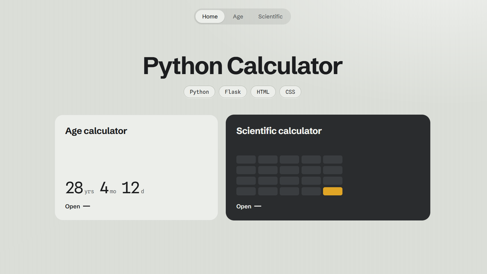
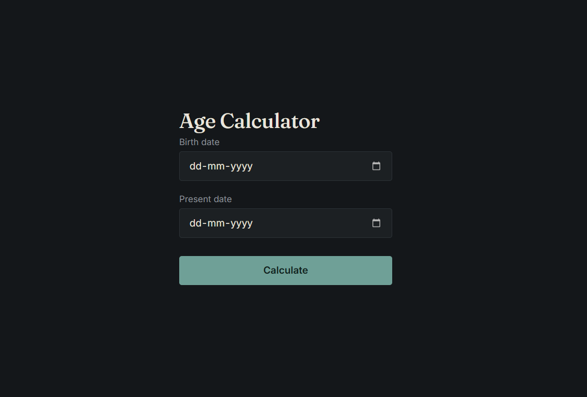
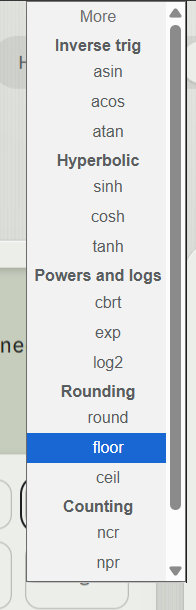
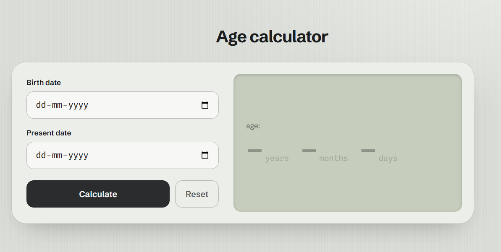
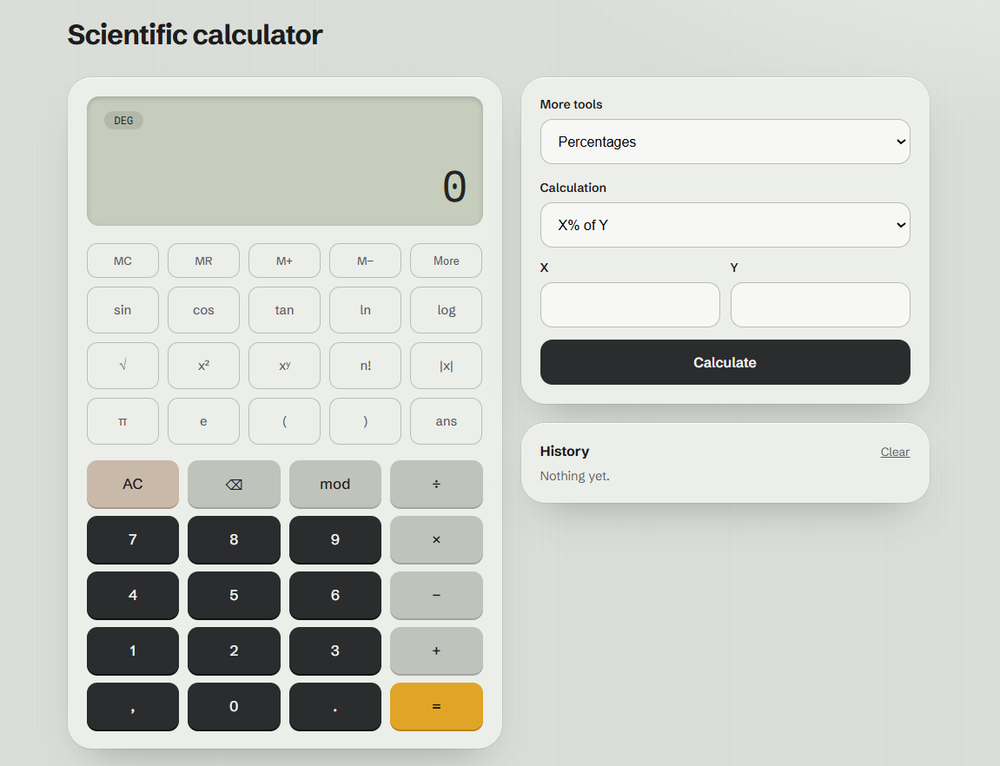

# Multi-Purpose Python Calculator Web App

[Website Link](https://pycalculator.vercel.app/)

A collaborative project featuring a collection of Python-powered calculation tools integrated into a Flask web interface.

(home page made during phase 2)

## Roadmap

### Phase 1: Age calculator
- [x] build age calc py script - [@Eren](https://github.com/shuvamm939-glitch)
- [x] design html/css ui for age calc and connect to flask website - [@thunderzz](https://github.com/thunderzz12)

(old phase 1 ui)

### Phase 2: Standard Calculator
- [x] create python script for standard calc - [@Eren](https://github.com/shuvamm939-glitch)
- [x] created 3 page routes for home, calc, age calc - [@thunderzz](https://github.com/thunderzz12)
<<<<<<< HEAD
- [ ] design calc ui and integrate to existing flask web. also better age-calc ui - [@thunderzz](https://github.com/thunderzz12)

### Phase 3: v2.0.1

**GitHub links**
- [ ] add project repo link on home page
- [ ] add github links of both collaborators in home page

**Changelog page**
- [ ] create /changelog route in flask
- [ ] design changelog page ui
- [ ] add changelog link in navbar

**Calculator fixes**
- [ ] test all buttons and find broken things
- [ ] fix the broken things

**Add more buttons**
- [ ] add more buttons
- [ ] design both buttons to match the ui

**Bracket bug**
- [ ] find why brackets give wrong result
- [ ] fix bracket handling in calc script
- [ ] test with cases like sin(5),sin 5

(phase 3 bugs we gonna fix)

## Collaborators
- [@Eren](https://github.com/shuvamm939-glitch)
- [@thunderzz](https://github.com/thunderzz12)
=======
- [x] design calc ui and integrate to existing flask web. also better age-calc ui - [@thunderzz](https://github.com/thunderzz12)

>>>>>>> 4493e27889264d3b5e434b434aa7aca1ae11dabf
